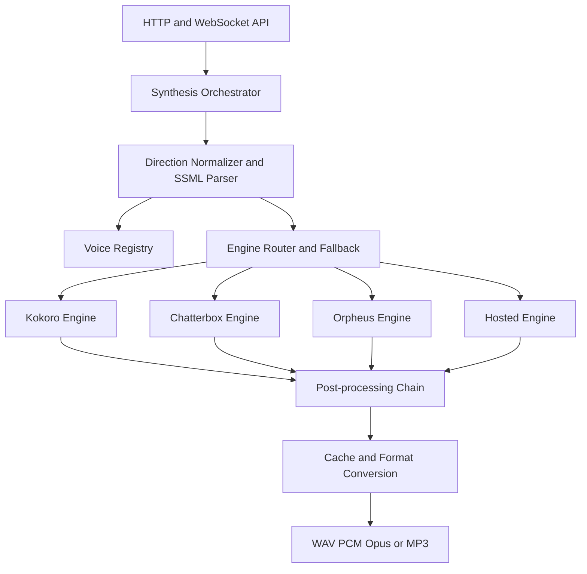

# Speech platform architecture

Target architecture for the Reactory speech service. It replaces a single Kokoro wrapper with a
registry, an adapter boundary and a provider-neutral direction model, while keeping the existing
HTTP and WebSocket contracts working.

## Layers



**Responsibilities**

| Layer | Owns | Must not own |
|---|---|---|
| API | Transport, validation, backwards compatibility | Model selection |
| Orchestrator | Voice resolution, direction lowering, fallback, applied/ignored reporting | Audio DSP |
| Registry | Voice identity, licence, provenance, capability flags | Inference |
| Engine adapter | Model lifecycle, native parameter mapping, inference | Public API shapes |
| Post-processing | Rate/pitch/volume/loudness/pause application | Voice identity |
| Cache | Keyed reuse of rendered audio | Policy |

## Core contracts

```python
class EngineCapabilities(BaseModel):
    engine: str
    languages: list[str]
    native_rate: bool
    native_pitch: bool
    native_volume: bool
    styles: list[str]
    supports_cloning: bool
    supports_streaming: bool
    supports_ssml: bool
    sample_rates: list[int]
    max_chars: int | None
    gpu_required: bool


class SynthesisRequest(BaseModel):
    text: str | None = None
    ssml: str | None = None
    voice: str | None = None
    engine: str | None = None            # explicit override
    language: str | None = None
    direction: Direction = Direction()
    pronunciation: dict[str, str] | None = None
    output_format: Literal["wav", "pcm", "mp3", "opus"] = "wav"
    sample_rate: int | None = None
    stream: bool = False
    cache: bool = True
    fallback: list[str] | None = None     # engine ids in order
```

Legacy fields (`text`, `voice`, `speed`, `is_phonemes`, `phonetic_preprocess`, `custom_lexicon`)
remain accepted on `POST /api/tts/synthesize` and are mapped onto the new model. `speed` is an
alias for `direction.prosody.rate`.

## Control lowering

| Control | Kokoro | Chatterbox Nano / Turbo | Orpheus | Hosted |
|---|---|---|---|---|
| rate | native `speed` 0.5–2.0 | generation params or post-process | generation params or post-process | native `speed` / SSML |
| pitch | post-process only | post-process only | partial | SSML `<prosody pitch>` |
| volume | gain | gain | gain | SSML / gain |
| pauses | sentence chunking plus silence insertion | punctuation plus chunking | punctuation and tags | `<break>` |
| emphasis | chunking or gain | punctuation and casing | tags | `instructions` / `<emphasis>` |
| style / emotion | **not supported** | exaggeration plus paralinguistic tags | emotive tags | natural-language instructions / `mstts:express-as` |
| cloning | no | yes, ~10 s reference | yes | provider-specific |

Anything in the "not supported" or "post-process only" cells is reported in `ignored` when the
caller asks for it. The matrix is exposed at `/api/tts/capabilities` so callers can make routing
decisions without hard-coding engine knowledge.

## API surface

Existing endpoints are unchanged. New endpoints:

| Method | Path | Purpose |
|---|---|---|
| `GET` | `/api/tts/voices` | List voices; filter by engine, language, tag, gender |
| `GET` | `/api/tts/voices/{id}` | Full voice descriptor |
| `GET` | `/api/tts/voices/{id}/preview` | Cached sample audio |
| `POST` | `/api/tts/voices/design` | Create a blended voice from a recipe |
| `POST` | `/api/tts/voices` | Register a voice descriptor |
| `DELETE` | `/api/tts/voices/{id}` | Remove a custom voice |
| `GET` | `/api/tts/capabilities` | Engines, languages, features, limits |
| `POST` | `/api/tts/synthesize` | Extended body; legacy fields unchanged |
| `WS` | `/api/tts/stream` | Per-message direction; binary audio frames unchanged |

## Response metadata

Synthesis responses carry enough information for a caller to understand what actually happened:

```
X-Audio-Duration: 4.21
X-Audio-Format: wav
X-Audio-Sample-Rate: 24000
X-Voice-Id: brand_aurora
X-Engine: kokoro
X-Direction-Applied: {"rate":0.95,"pauses":"natural"}
X-Direction-Ignored: pitch,style
X-Cache: hit
X-Cache-Tier: lru
```

`X-Cache` is `hit` or `miss`; `X-Cache-Tier` is `lru`, `disk` or `none`. A caller that needs a fresh
render sends `"cache": false` in the body; `SPEECH_CACHE_ENABLED=false` disables the cache for the
whole deployment. A hit returns the stored bytes verbatim, so audio and duration are identical to
the response that populated the entry.

The current service sends `X-Audio-Sample-Rate` while the TypeScript client reads `x-sample-rate`,
so the sample rate always defaults to 24000. Phase 0 fixes the mismatch; Phase 1 adds the new
headers.

## SSML

SSML is parsed once into per-span direction and synthesised span by span. It is never forwarded to
an engine that cannot consume it. This gives consistent behaviour across engines.

```xml
<speak>
  <p>
    <s>Welcome back, <emphasis level="strong">Werner</emphasis>.</s>
    <break time="400ms"/>
    <s><prosody rate="slow" pitch="-2st">Let's pick up where we left off.</prosody></s>
  </p>
</speak>
```

## Streaming protocol

Binary audio frames and the trailing `{"done": true, ...}` message are unchanged. Optional
control frames are additive:

```json
{ "type": "start", "voice": "af_heart", "direction": { "style": "calm" }, "output_format": "pcm" }
{ "type": "text", "text": "First sentence." }
{ "type": "flush" }
```

The server sends a `{"type": "meta", ...}` frame before the first audio frame so the client can
show which controls were honoured.

## Concurrency and lifecycle

Inference is CPU- or GPU-bound and must not run on the event loop. Every engine call is dispatched
to a bounded thread pool with a per-engine semaphore (`kokoro: 2`, `chatterbox: 1`, `gpu: 1`).
`EngineManager` lazy-loads engines, enforces `max_loaded_engines`, unloads idle engines and reports
per-engine readiness from `/health` and `/ready`.

**Thread pool.** `app/services/inference.py` owns an explicit, bounded
`ThreadPoolExecutor` (`SPEECH_THREAD_POOL_SIZE`, default 4). Handlers `await` the pool; they never
call an engine inline. The pool is separate from the shared anyio pool, so synchronous route
handlers and streaming uploads cannot starve synthesis of threads.

**Per-engine limits.** `app/engines/concurrency.py` wraps a semaphore and the counters an operator
needs: `in_flight`, `queue_depth` (waiting), `peak_concurrency`. Limits come from
`SPEECH_ENGINE_MAX_CONCURRENCY`, a JSON map (`{"kokoro": 2, "default": 1}`). Two kokoro renders may
overlap; a GPU or expressive engine is limited to one so VRAM is not oversubscribed.

**Grapheme-to-phoneme is a serialised critical section — and nothing else is.** espeak-ng keeps its
configuration and synthesis state in process globals and is not thread-safe, and `phonemizer`
caches one `EspeakBackend` per language for the whole process. Every G2P call therefore holds
`app.services.phonetic_converter.G2P_LOCK`: the converter's own path, and Kokoro's own tokenizer.
Raising the engine concurrency without this lock silently produced wrong phonemes at two workers
(cross-request contamination and, worse, prose returned where IPA was expected).

The lock must never span inference. `kokoro_onnx.Kokoro.create(..., is_phonemes=False)` phonemises
*and* runs the ONNX session inside one Python call, so wrapping that call would serialise every
render whenever phonetic preprocessing is off (`"phonetic_preprocess": false`, or
`PHONETIC_PROCESSING_ENABLED=false`) — the per-engine limit would be defeated and surplus renders
would fill the inference pool waiting on the lock. `KokoroEngine._render` therefore splits the two
steps: `tokenizer.phonemize()` under `G2P_LOCK` (~1-3 ms), then
`create(..., is_phonemes=True)` outside it. That is byte-for-byte the sequence `create` performs
internally. A model adapter that exposes no `tokenizer` cannot be split and keeps the serialised
shape.

**The persistent lexicon is copy-on-write.** Renders run in the pool while `POST`/`DELETE
/api/tts/lexicon` mutate the custom lexicon from the event loop; a dict iterated in one thread and
mutated in another raises `RuntimeError: dictionary changed size during iteration`, which reached the
client as a 500 on a valid synthesis. Readers (`normalize_text`, `convert_to_phonetic`,
`get_entry`, `get_all_entries`, `get_custom_entries`) take a snapshot under
`PhoneticConverter._lexicon_lock` and iterate that; mutations build a new mapping, persist it
atomically (`tempfile` + `os.replace`) and only then publish it. A reader therefore never sees a
partial update, a vanished entry, or a half-written file — the last of which used to let a render
fail to parse the lexicon, keep the *old* entries, and still be cached under a fingerprint computed
from the *new* file. The lexicon lock is deliberately separate from `G2P_LOCK`: a lexicon mutation
must not wait behind an espeak call.

**Lifecycle.** `EngineManager.initialize()` loads up to `SPEECH_MAX_LOADED_ENGINES` engines at
startup and defers the rest to first use (`ensure_loaded`). Loading a new engine evicts the least
recently used *idle* engine; if every loaded engine is busy the request fails with
`EngineCapacityError` instead of exceeding the memory budget. An engine idle for
`SPEECH_ENGINE_IDLE_TIMEOUT_SECONDS` is unloaded by the background reaper, and one engine is always
kept resident so readiness and the next request never pay a cold load.

**Health.** `/health` keeps `status`, `tts`, `stt` and `version` and adds:

```json
{
  "engines": {
    "kokoro": {
      "id": "kokoro", "ready": true, "loaded": true, "lifecycle": "ready",
      "queue_depth": 0, "in_flight": 2, "max_concurrency": 2,
      "peak_concurrency": 2, "idle_seconds": 1.204,
      "gpu_required": false, "max_chars": 10000, "voices": 54
    }
  },
  "queue_depth": 0,
  "cache": {"enabled": true, "hits": 12, "misses": 3, "ttl_seconds": 86400, "lru_entries": 12}
}
```

`/ready` keeps `ready` and adds the same `engines` map and `queue_depth`. `tts` means "an engine is
loaded right now"; a registered engine that is unloaded can still serve the next request through a
lazy load, which is why requests are admitted on "an engine exists" rather than "an engine is
resident".

### Synthesis cache

Two tiers, both local to the node — there is no Redis and no hosted cache (`OUT OF SCOPE` for the
edge profile):

| Tier | Bound | Purpose |
|---|---|---|
| in-process LRU | `SPEECH_CACHE_LRU_ENTRIES`, `SPEECH_CACHE_LRU_MAX_BYTES`, per-entry ceiling | hot phrases and previews |
| disk | `SPEECH_CACHE_DIR`, `SPEECH_CACHE_TTL_SECONDS`, `SPEECH_CACHE_DISK_MAX_BYTES` | longer text, survives a restart |

The key is a SHA-256 over `text | voice id | direction | engine id | output format | sample rate`,
plus the legacy switches that also change the audio (`is_phonemes`, `phonetic_preprocess`,
`custom_lexicon`). The voice is the engine-resolved id, so two spellings of one voice share an entry
and a changed default voice does not reuse stale audio. Writes are atomic (`os.replace`); an expired
or truncated entry is a miss, never a corrupt response. Cache lookups happen *before* an engine is
loaded, so a repeated preview does not pay the model-load cost.

The key is the per-request identity. Inputs that change the audio but are decided by the
*deployment* are folded into it as a **renderer fingerprint** (`renderer_fingerprint()`):

| Fingerprint input | Why |
|---|---|
| persistent lexicon (`data/lexicon.json`, by `mtime_ns` and size) | an operator can mutate it at runtime through `POST /api/tts/lexicon` |
| `KOKORO_DEFAULT_SPEED` | applied when the caller expresses no rate, while the key records `Direction()`'s default rate |
| `PHONETIC_PROCESSING_ENABLED` | picks the render path when `phonetic_preprocess` is `None` |
| application version (`app.__version__`) | covers the built-in lexicon, the normalisation rules and the render code |
| model and voice-pack identity (`mtime_ns`, size) | swapping the ONNX model or the voices bundle changes the audio |

A pronunciation fix, a default-speed change, a model swap or a deploy therefore produces a miss
immediately instead of serving stale audio for the whole TTL — which the disk tier would otherwise do
across restarts. Old entries become unreachable and are reclaimed by the LRU and disk byte caps, so
no explicit invalidation is needed.

The fingerprint is only as good as its inputs: **a persisted `SPEECH_CACHE_DIR` across a deploy is
only as fresh as this fingerprint.** Bump `app.__version__` for a change that alters audio without
altering any of the other inputs, and keep the model files' identity meaningful (do not rewrite them
with identical content in a way that preserves `mtime`). Everything here is file metadata plus
settings, so the cost is a handful of `stat` calls per synthesis — no file contents are read or
hashed.

Every entry carries the time it was stored, and **both** tiers enforce `SPEECH_CACHE_TTL_SECONDS`.
The in-process LRU needs that check as much as the disk tier: a hot phrase is never evicted by
pressure, so without it a shortened TTL would never apply to exactly the entries the LRU exists to
serve. An expired LRU entry is dropped and counted as an eviction rather than served.

## Deployment profiles

| Profile | Contents | Approx footprint | Use |
|---|---|---|---|
| `speech-core` | Kokoro ONNX + faster-whisper | ~350 MB models, ≤2048 MiB image | Default, laptop, edge node |
| `speech-expressive` | adds Chatterbox Nano/Turbo + torch | +2–3 GB | Brand voices, expressive delivery |
| `speech-gpu` | adds Orpheus or a large model | multi-GB, GPU | Premium acting tier |

The API surface is identical across profiles. `/capabilities` reports which engines are present, so
a client adapts rather than fails.

### Image budget

The `speech-core` image has a hard ceiling of **2048 MiB (2 GiB) uncompressed**, asserted in CI by
`scripts/check_image_size.sh` (also runnable as `make image-size`). The ceiling exists so the edge
budget cannot silently regress: adding a dependency that drags in torch, CUDA or a second runtime
fails the build rather than the deployment. Tighten the constant when a build lands comfortably
below it; never raise it without recording why here.

## Testing strategy

- Unit tests per adapter with a deterministic engine stub.
- Contract tests asserting the `applied` / `ignored` payload for each direction and engine pair.
- A golden-corpus regression test that renders a fixed set of sentences and asserts duration
  bounds and round-trip WER via the STT service.
- A concurrency smoke test that fires simultaneous long syntheses plus `/health` probes and asserts
  that health responds while renders are in flight (including a render held for several seconds),
  that renders overlap, and that they run on worker threads (`tests/test_concurrency.py`).
- Concurrency across *every* render path, not just the default one: with phonetic preprocessing
  disabled the engine must still reach its configured limit and must not occupy pool threads while
  waiting (`tests/test_concurrency.py`).
- Cache tests covering hit/miss, byte identity, TTL expiry, key components, the renderer
  fingerprint and both disable switches (`tests/test_synthesis_cache.py`,
  `tests/test_synthesis_cache_api.py`).
- Lexicon concurrency tests: renders through the inference pool while the lexicon endpoint mutates
  entries, a deterministic mid-iteration interleaving, and atomic-persistence checks
  (`tests/test_lexicon_concurrency.py`).
- Lifecycle tests covering lazy load, `max_loaded_engines`, idle unload/reload and the health shape
  (`tests/test_engine_lifecycle.py`).
- An image-size assertion for `speech-core` so the edge budget cannot silently regress
  (`scripts/check_image_size.sh`, enforced by `.github/workflows/ci.yml`).
- G2P thread-safety tests: 2 threads x N calls of two distinct sentences assert each call returns its
  own phonemes, plus structural tests that the shared tokenizer and Kokoro's internal phonemisation
  never overlap (`tests/test_g2p_concurrency.py`, no model files needed).
