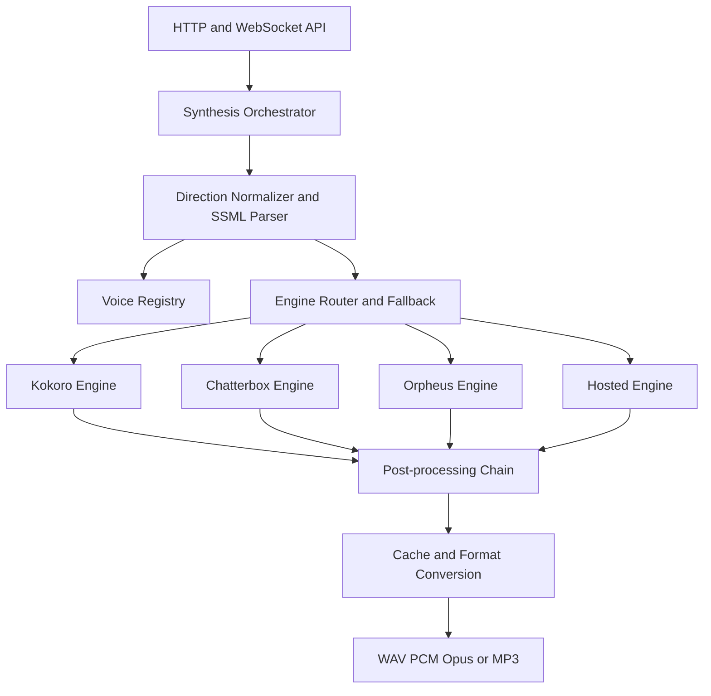

# Speech platform architecture

Target architecture for the Reactory speech service. It replaces a single Kokoro wrapper with a
registry, an adapter boundary and a provider-neutral direction model, while keeping the existing
HTTP and WebSocket contracts working.

## Layers



**Responsibilities**

| Layer | Owns | Must not own |
|---|---|---|
| API | Transport, validation, backwards compatibility | Model selection |
| Orchestrator | Voice resolution, direction lowering, fallback, applied/ignored reporting | Audio DSP |
| Registry | Voice identity, licence, provenance, capability flags | Inference |
| Engine adapter | Model lifecycle, native parameter mapping, inference | Public API shapes |
| Post-processing | Rate/pitch/volume/loudness/pause application | Voice identity |
| Cache | Keyed reuse of rendered audio | Policy |

## Core contracts

```python
class EngineCapabilities(BaseModel):
    engine: str
    languages: list[str]
    native_rate: bool
    native_pitch: bool
    native_volume: bool
    styles: list[str]
    supports_cloning: bool
    supports_streaming: bool
    supports_ssml: bool
    sample_rates: list[int]
    max_chars: int | None
    gpu_required: bool


class SynthesisRequest(BaseModel):
    text: str | None = None
    ssml: str | None = None
    voice: str | None = None
    engine: str | None = None            # explicit override
    language: str | None = None
    direction: Direction = Direction()
    pronunciation: dict[str, str] | None = None
    output_format: Literal["wav", "pcm", "mp3", "opus"] = "wav"
    sample_rate: int | None = None
    stream: bool = False
    cache: bool = True
    fallback: list[str] | None = None     # engine ids in order
```

Legacy fields (`text`, `voice`, `speed`, `is_phonemes`, `phonetic_preprocess`, `custom_lexicon`)
remain accepted on `POST /api/tts/synthesize` and are mapped onto the new model. `speed` is an
alias for `direction.prosody.rate`.

## Control lowering

| Control | Kokoro | Chatterbox Nano / Turbo | Orpheus | Hosted |
|---|---|---|---|---|
| rate | native `speed` 0.5–2.0 | generation params or post-process | generation params or post-process | native `speed` / SSML |
| pitch | post-process only | post-process only | partial | SSML `<prosody pitch>` |
| volume | gain | gain | gain | SSML / gain |
| pauses | sentence chunking plus silence insertion | punctuation plus chunking | punctuation and tags | `<break>` |
| emphasis | chunking or gain | punctuation and casing | tags | `instructions` / `<emphasis>` |
| style / emotion | **not supported** | exaggeration plus paralinguistic tags | emotive tags | natural-language instructions / `mstts:express-as` |
| cloning | no | yes, ~10 s reference | yes | provider-specific |

Anything in the "not supported" or "post-process only" cells is reported in `ignored` when the
caller asks for it. The matrix is exposed at `/api/tts/capabilities` so callers can make routing
decisions without hard-coding engine knowledge.

## API surface

Existing endpoints are unchanged. New endpoints:

| Method | Path | Purpose |
|---|---|---|
| `GET` | `/api/tts/voices` | List voices; filter by engine, language, tag, gender |
| `GET` | `/api/tts/voices/{id}` | Full voice descriptor |
| `GET` | `/api/tts/voices/{id}/preview` | Cached sample audio |
| `POST` | `/api/tts/voices/design` | Create a blended voice from a recipe |
| `POST` | `/api/tts/voices` | Register a voice descriptor |
| `DELETE` | `/api/tts/voices/{id}` | Remove a custom voice |
| `GET` | `/api/tts/capabilities` | Engines, languages, features, limits |
| `POST` | `/api/tts/synthesize` | Extended body; legacy fields unchanged |
| `WS` | `/api/tts/stream` | Per-message direction; binary audio frames unchanged |

## Response metadata

Synthesis responses carry enough information for a caller to understand what actually happened:

```
X-Audio-Duration: 4.21
X-Audio-Format: wav
X-Audio-Sample-Rate: 24000
X-Voice-Id: brand_aurora
X-Engine: kokoro
X-Direction-Applied: {"rate":0.95,"pauses":"natural"}
X-Direction-Ignored: pitch,style
```

The current service sends `X-Audio-Sample-Rate` while the TypeScript client reads `x-sample-rate`,
so the sample rate always defaults to 24000. Phase 0 fixes the mismatch; Phase 1 adds the new
headers.

## SSML

SSML is parsed once into per-span direction and synthesised span by span. It is never forwarded to
an engine that cannot consume it. This gives consistent behaviour across engines.

```xml
<speak>
  <p>
    <s>Welcome back, <emphasis level="strong">Werner</emphasis>.</s>
    <break time="400ms"/>
    <s><prosody rate="slow" pitch="-2st">Let's pick up where we left off.</prosody></s>
  </p>
</speak>
```

## Streaming protocol

Binary audio frames and the trailing `{"done": true, ...}` message are unchanged. Optional
control frames are additive:

```json
{ "type": "start", "voice": "af_heart", "direction": { "style": "calm" }, "output_format": "pcm" }
{ "type": "text", "text": "First sentence." }
{ "type": "flush" }
```

The server sends a `{"type": "meta", ...}` frame before the first audio frame so the client can
show which controls were honoured.

## Concurrency and lifecycle

Inference is CPU- or GPU-bound and must not run on the event loop. Every engine call is dispatched
to a bounded thread pool with a per-engine semaphore (`kokoro: 2`, `chatterbox: 1`, `gpu: 1`).
`EngineManager` lazy-loads engines, enforces `max_loaded_engines`, unloads idle engines and reports
per-engine readiness from `/health` and `/ready`.

## Deployment profiles

| Profile | Contents | Approx footprint | Use |
|---|---|---|---|
| `speech-core` | Kokoro ONNX + faster-whisper | ~350 MB models | Default, laptop, edge node |
| `speech-expressive` | adds Chatterbox Nano/Turbo + torch | +2–3 GB | Brand voices, expressive delivery |
| `speech-gpu` | adds Orpheus or a large model | multi-GB, GPU | Premium acting tier |

The API surface is identical across profiles. `/capabilities` reports which engines are present, so
a client adapts rather than fails.

## Testing strategy

- Unit tests per adapter with a deterministic engine stub.
- Contract tests asserting the `applied` / `ignored` payload for each direction and engine pair.
- A golden-corpus regression test that renders a fixed set of sentences and asserts duration
  bounds and round-trip WER via the STT service.
- An image-size assertion for `speech-core` so the edge budget cannot silently regress.
