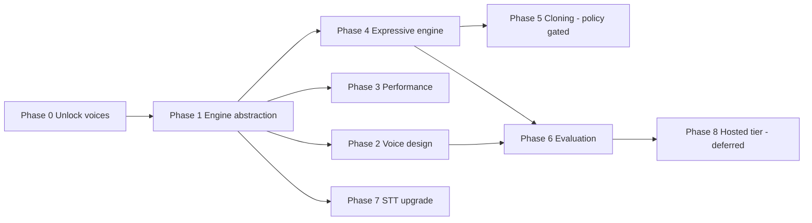

# Voice and expression roadmap

Phased delivery plan for turning the speech service from a fixed Kokoro wrapper into an
open-source, edge-first speech platform. Every phase is one support ticket so it can be worked,
reviewed and merged independently.

Direction is fixed by [ADR-0001](../adr/0001-open-source-edge-first-speech-platform.md): open
source, self-hosted, CPU/edge first, no paid API required, permissively licensed models only.

## Sequencing rationale

Phases are ordered by **dependency and risk**, not by visible impact:

- Phase 0 removes a hard-coded allow-list and has no architectural risk. It is worth doing first
  because it delivers 5× the voices immediately and makes the rest of the work testable.
- Phase 1 introduces the adapter boundary. Every later engine and every tone feature depends on
  it, so it must land before any model is added.
- Phases 2 and 4 are additive to the boundary and can run in parallel once Phase 1 is merged.
- Phase 5 (cloning) is a policy question before it is an engineering question, so it is gated.
- Phase 6 produces the evidence needed to make routing decisions, so it follows the first two
  engines.

---

## Phase 0 — Unlock the voice catalogue

**Ticket:** `SPEECH-001` · **Priority:** high · **Type:** bug + feature · **Depends on:** none

**Problem.** The voice pack contains 54 voices across 9 language families. Three separate
hard-coded allow-lists expose 11 of them, and the voice-listing endpoint the client calls does not
exist.

**Scope**

- Derive the voice list from `Kokoro.voices` instead of a literal dict.
- Seed metadata (language, gender, quality grade, attribution) from the shipped pack.
- Add `GET /api/tts/voices` and `GET /api/tts/voices/{id}`.
- Add `GET /api/tts/capabilities` reporting the single current engine.
- Clamp `speed` to the range the library actually supports, returning 422 outside it.
- Fix the audio sample-rate header mismatch.
- Remove the duplicated voice lists from the TypeScript client; fetch and cache instead.

**Acceptance criteria**

- All 54 voices are listed and each one synthesises without error.
- An invalid `speed` returns 422, not 500.
- The client reports the real voice list and the real sample rate.
- Existing callers using `af_heart` are unaffected.
- Tests cover the voice list, the voice descriptor, the capabilities payload and the speed
  validation boundary.

**Deliberately out of scope.** Any change to the synthesis architecture. This phase must be
small enough to merge without reviewing the rest of the roadmap.

---

## Phase 1 — Engine abstraction and direction model

**Ticket:** `SPEECH-002` · **Priority:** high · **Type:** feature · **Depends on:** Phase 0

Introduces the structures in [ADR-0002](../adr/0002-engine-adapter-and-voice-registry.md):
contracts, registry, router, direction lowering, capability negotiation and the
`applied` / `ignored` response contract. Kokoro becomes the only adapter, so behaviour is
unchanged for callers who send nothing new.

**Acceptance criteria**

- `synthesize` accepts an optional `direction` object; requests without it behave exactly as
  before.
- `POST /api/tts/synthesize` still accepts `text`, `voice`, `speed`, `is_phonemes`,
  `phonetic_preprocess` and `custom_lexicon`.
- Kokoro reports `rate` as applied and `pitch` / `style` as ignored.
- `GET /api/tts/capabilities` describes the engine including `gpu_required: false`.
- A registry file is the only source of voice data; no voice literal remains in service code.
- Unit tests cover direction lowering and the applied/ignored payload for at least rate, pitch and
  style.

---

## Phase 2 — Voice design by blending

**Ticket:** `SPEECH-003` · **Priority:** medium · **Type:** feature · **Depends on:** Phase 1

Kokoro voices are style tensors of identical shape, so weighted blends produce new voice
identities with no training and no new model. See
[the voice catalogue](../voices/kokoro-voice-catalogue.md).

**Scope**

- `POST /api/tts/voices/design` accepting 2–4 base voices with weights.
- Normalise weights, constrain blends to one language family, enforce a minimum dominant weight.
- Cache the resolved tensor; persist the recipe (not the tensor) in the registry.
- Generate and cache a preview clip on creation.
- Ship a small preset library: Warm Narrator, Calm Assistant, Bright Support, Steady Narration.
- `GET /api/tts/voices/{id}/preview` serves the cached clip.

**Acceptance criteria**

- A designed voice can be created, previewed, used for synthesis and survives a restart.
- A blend across language families is rejected with a clear 422.
- A blend with fewer than two components, or with a weight sum of zero, is rejected.
- Creating 20 designed voices does not re-download or copy the model.
- Blending is documented as changing timbre, **not** emotion.

---

## Phase 3 — Performance and reliability

**Ticket:** `SPEECH-004` · **Priority:** high · **Type:** refactor · **Depends on:** Phase 1

The service currently runs blocking inference inside `async def` handlers, so one long synthesis
blocks every other request. This phase makes it safe to run more than one engine on one node.

**Scope**

- Move inference to a bounded thread pool with a per-engine semaphore.
- Add a two-tier synthesis cache keyed on text, voice, direction, engine, format and sample rate.
- Add `EngineManager` with lazy load, `max_loaded_engines` and idle unload.
- Report per-engine readiness and queue depth from `/health` and `/ready`.
- Assert the `speech-core` image size in CI so the edge budget cannot regress silently.

**Acceptance criteria**

- Ten concurrent long syntheses do not serialise behind each other and do not block `/health`.
- A repeated identical request is served from cache within a stated latency budget.
- Loading a second engine respects `max_loaded_engines` and unloads an idle engine.
- A cache hit is observable (header or metric) and does not change the audio bytes.

---

## Phase 4 — Expressive engine

**Ticket:** `SPEECH-005` · **Priority:** medium · **Type:** feature · **Depends on:** Phase 1

Adds tone and acting. Kokoro can change pace but cannot change mood; this phase adds a second
adapter that can, without changing the default deployment.

At the measured throughput this is an **asynchronous / batch narration** capability, not an
interactive one: a 2–3 s reply costs 15–25 s of a CPU core.

**Engine choice.** Chatterbox (MIT) — `ChatterboxTTS` (2.13 GB t3) and `ChatterboxTurboTTS`
(1.92 GB t3), both supporting paralinguistic tags (`[laugh]`, `[chuckle]`) and zero-shot reference
voices. Orpheus (Apache-2.0) is the higher-quality GPU option and is deferred to a GPU profile.

> **Measured, and it changes the plan.** The earlier claim of *"Nano 110M at roughly 3× realtime on
> 8 cores"* came from upstream docs and does not survive measurement on our hardware: **RTF 0.13**,
> i.e. ~7.7× *slower* than realtime, with no thread scaling because the bottleneck is sequential
> token decoding. Thread count is therefore not the lever. There is also no `Nano` class in
> chatterbox-tts 0.1.7, and the shared 1 GB S3Gen vocoder means no variant is a small download.
> Details and numbers: [`../measurements/chatterbox-cpu.md`](../measurements/chatterbox-cpu.md).

**Scope**

- New `app/engines/chatterbox.py` adapter behind the existing contract.
- Deploy in a separate `speech-expressive` profile; the default image must not grow.
- Map the internal `style` vocabulary onto available expressiveness controls and tags.
- Report styles the engine cannot honour in `ignored`.
- Feature-flag the engine, default off.
- **Neutralise `model.watermarker`.** The engine applies a Perth watermark on every return path with
  no off switch; ADR-0003 decision 4 requires clean production audio, so this is a mandatory adapter
  step, not a flag.
- Hold `exaggeration` to roughly **0.3–0.7**: it co-varies with pace (~30% faster at 1.0) and high
  values degrade diction seriously enough that our own STT mis-hears brand names.
- Declare a **compute-cost advisory** in `/capabilities`, because at RTF 0.13 the routing signal is
  cost-per-second, not `native_rate`.

**Acceptance criteria**

- `style: "empathetic"` routes to Chatterbox and audibly differs from `style: "neutral"` on the
  same text and voice.
- Production-mode output carries **no Perth watermark**; a dev-mode test asserts it is present when
  not neutralised. (Asserted, not assumed — the engine applies it unconditionally.)
- No `prosody.rate` is applied on top of `exaggeration` without a measured statement of the combined
  effect, given the two controls interact.
- The default image size and startup time are unchanged.
- `/capabilities` reports the expressive engine only when its profile is deployed.
- A missing model degrades to Kokoro with a clear `ignored` entry, not a 500.
- Licence and attribution metadata for the engine is present in the registry.

---

## Phase 5 — Consent-first voice cloning

**Ticket:** `SPEECH-006` · **Priority:** medium · **Type:** feature · **Status:** blocked on policy

Cloning is a governance problem before it is an engineering problem. This ticket must not start
until the consent and watermarking policy is approved and recorded as an ADR.

**Preconditions**

- An approved ADR covering consent records, retention and deletion.
- A named approver for customer-facing voices.
- Confirmation that watermarking stays enabled by default.

**Scope once unblocked**

- `POST /api/tts/voices/clone` with reference audio plus a consent record.
- Encrypted reference storage, embedding cache, delete endpoint.
- Watermarking on by default where the engine supports it.
- Provenance surfaced by `/api/tts/voices/{id}`.

---

## Phase 6 — Evaluation and routing

**Ticket:** `SPEECH-007` · **Priority:** medium · **Type:** feature · **Depends on:** Phases 1–4

You cannot manage voices you cannot measure. This phase produces the evidence for routing and for
accepting or rejecting model upgrades.

**Scope**

- Golden corpus of representative Reactory sentences, including domain vocabulary.
- Harness that renders the corpus through every enabled engine and voice.
- Metrics: round-trip WER via the STT service, duration bounds, time-to-first-audio, real-time
  factor, peak memory, speaker-consistency cosine against a reference.
- Stored per engine and version; a simple report command.
- A routing policy module that selects an engine from direction, language and tier, with the
  measured scores as input.

**Acceptance criteria**

- The harness runs locally with no network access and no paid service.
- A deliberately broken engine (muted or truncated output) is caught by the WER or duration check.
- Results are comparable across runs and committed as a baseline.

---

## Phase 7 — Speech-to-text upgrade

**Ticket:** `SPEECH-008` · **Priority:** medium · **Type:** feature · **Depends on:** none

Independent of TTS, but part of the same end-to-end promise.

**Scope**

- Voice-activity detection before transcription instead of writing a whole file first.
- Real chunked streaming over the existing WebSocket.
- Word-level timestamps for captions and highlighting.
- Delete temporary audio files (the current implementation leaks them).
- Model tiering by accuracy/latency budget, still local and permissively licensed.

---

## Phase 8 — Optional hosted premium tier

**Ticket:** `SPEECH-009` · **Priority:** low · **Type:** feature · **Status:** deferred

Only if a commercial tier requires capabilities the local stack cannot reach. Adds an adapter, not
a dependency.

**Guardrails**

- Disabled by default; requires explicit configuration.
- Never used as a fallback for a local engine failure.
- Cost and latency budgets with a circuit breaker.
- `/capabilities` marks which engines are remote so a deployment can prove it is fully local.

---

## Deferred and rejected

| Item | Reason |
|---|---|
| XTTS v2 | CPML licence is non-commercial; conflicts with ADR-0001 |
| F5-TTS | CC-BY-NC weights; research only |
| Building a bespoke TTS model | No training licence, no advantage over adapting open weights |
| Passing raw SSML to Kokoro | Kokoro cannot consume it; parse and lower instead |
| Voice libraries per client | Three disagreeing lists already exist; the service is the source of truth |
